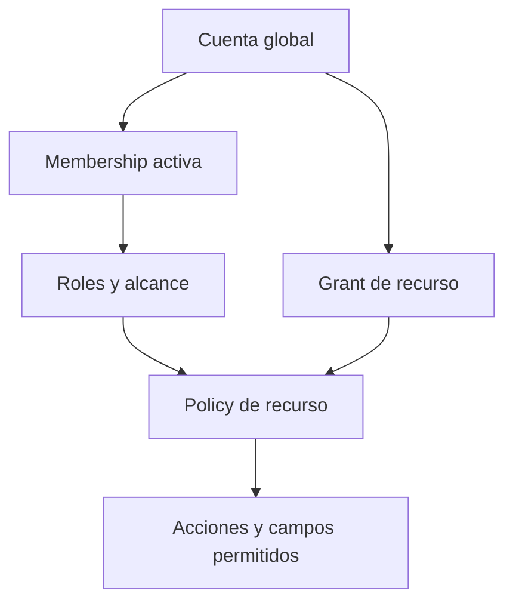
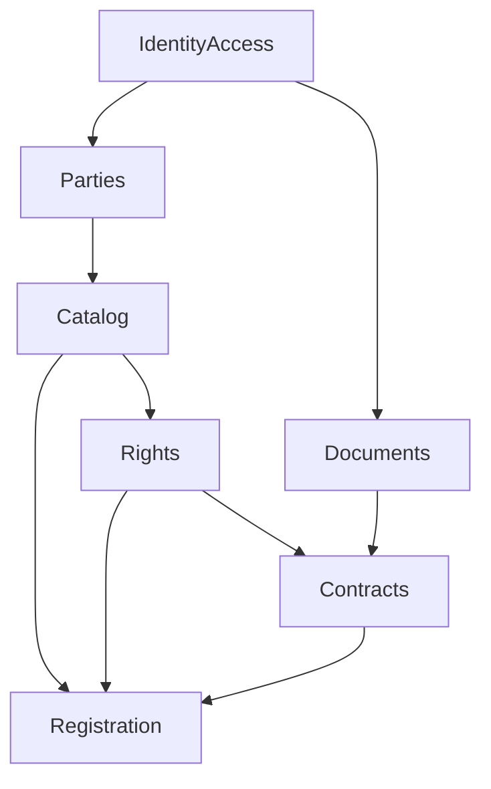
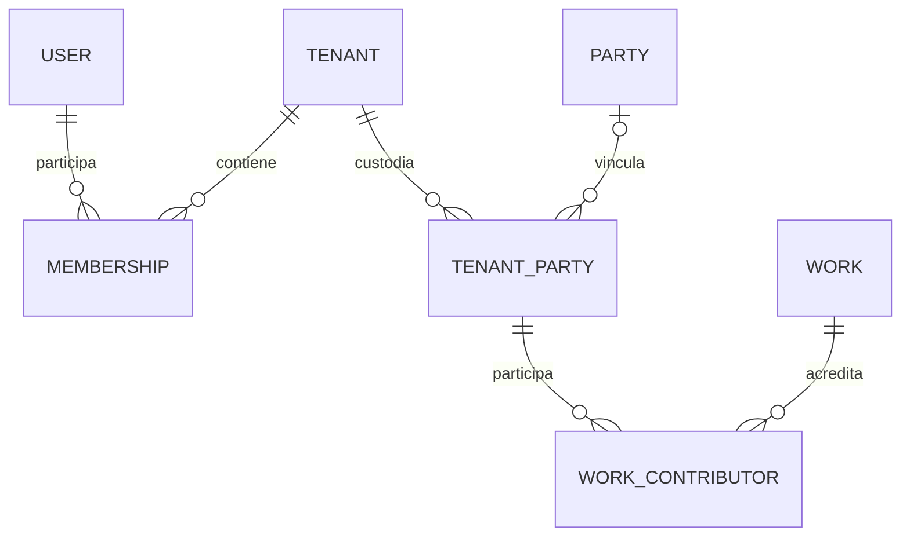
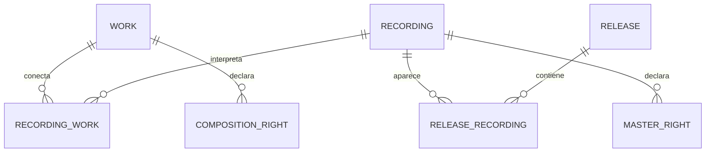
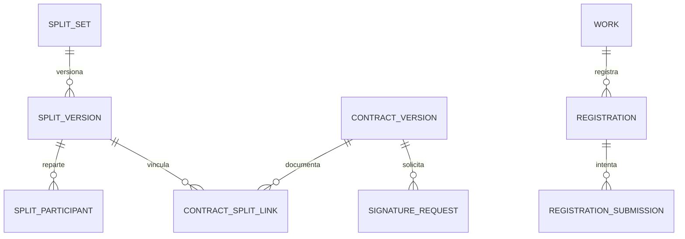

# Ascanio Publishing Platform

Plataforma SaaS independiente para organizar la operación musical de sellos, editoriales, empresas de management y profesionales independientes.

**Estado al 12 de octubre de 2026:** diseño de arquitectura. El repositorio contiene documentación; no existe todavía un scaffold Laravel, aplicación, migraciones ni pipeline ejecutable. Los modelos y módulos de este documento son el diseño objetivo, no funcionalidades implementadas.

**Objetivo del MVP:** gestionar participantes, catálogo, derechos, splits, contratos, firmas y registros con acceso individual y aislamiento entre espacios de trabajo.

## 1. Producto y actores

Ascanio centraliza información reutilizable y la convierte en procesos guiados. Un compositor puede gestionar una obra sin grabación; un artista puede gestionar su proyecto; una editorial puede administrar una fracción de derechos; un sello puede operar un catálogo; un manager puede representar varios artistas.

Actividades configurables, combinables y extensibles: sello, editorial, management, artista independiente, productor, compositor y negocio híbrido. Describen la operación y ayudan al onboarding; no definen aplicaciones diferentes ni una jerarquía legal.

| Actor | Relación con el producto |
|---|---|
| Operador de Ascanio | Administra el servicio SaaS y sus tenants |
| Organización o profesional | Opera un espacio de trabajo y su catálogo privado |
| Owner del workspace | Controla membresías, configuración y transferencia del espacio |
| Equipo operativo | Metadata, A&R, legal, finanzas y gestión según permisos |
| Artista, DJ, músico, compositor o productor | Participa en recursos; puede tener su propio workspace |
| Manager o representante | Gestiona artistas concretos mediante relaciones y autorizaciones |
| Publisher o titular | Posee, administra o recauda derechos con un alcance documentado |
| Colaborador externo | Completa sus datos, consulta su participación y firma recursos autorizados |
| Sociedad, proveedor de firma o distribuidor | Destino o integración externa |

Las relaciones son una red. Un artista no pertenece exclusivamente a un sello; una obra puede tener varios autores, grabaciones y administradores.

## 2. Decisiones de diseño

| Decisión | Motivo y ventaja | Impacto y riesgo a controlar |
|---|---|---|
| Monolito modular | Transacciones simples y menor carga operativa para un equipo pequeño | Evitar servicios gigantes y dependencias circulares |
| PostgreSQL compartido con `tenant_id` | Usuarios con varios espacios y colaboración sin administrar una BD por cliente | Todas las consultas, relaciones, exports y jobs deben aplicar aislamiento |
| Identidad global mínima + fichas privadas por tenant | Reutiliza personas sin compartir automáticamente sus datos | Vinculación verificada, consentimiento y snapshots |
| RBAC + alcance por recurso + policies | Los roles operativos no bastan para artistas, managers o invitados | Listados, campos, adjuntos y acciones deben aplicar la misma policy |
| `Work` equivale a composición; `Recording` representa grabación | Evita duplicar obras/composiciones y separa derechos | Relación N:M para varias obras/grabaciones |
| Derechos separados del reparto de ingresos | Un productor puede recibir ingresos sin ser titular del master | Exigir base del porcentaje, derecho, territorio, vigencia y evidencia |
| Inertia para la primera web | Reduce una segunda capa frontend sin acoplar reglas al renderizado | Acciones y DTOs reutilizables; no duplicar cada endpoint como REST |
| Portal limitado de participantes en MVP | Consultar y aceptar splits pertenece al flujo inicial | EPK, web pública y pagos pasan a fases posteriores |
| CWR acotado por versión y destinatario | Entrega verificable | No prometer compatibilidad universal ni marcar exportación como registro |
| Branding básico en MVP | Logo, colores y nombre | Dominios propios y SMTP por cliente requieren validación operativa posterior |

Estas decisiones refinan los planes anteriores. La visión 360º se conserva; no se crean veinte módulos vacíos ni un motor genérico de workflows.

## 3. Modelo conceptual

| Concepto | Representación | Regla |
|---|---|---|
| `User` | Entidad global de autenticación | Cuenta individual; sin rol de negocio global, bancos ni porcentajes |
| `Party` | Identidad global mínima de persona u organización | Referencia estable; no concede acceso ni crea un directorio abierto |
| `Person` | Subtipo de Party | Persona real, con o sin cuenta y con posibles alias artísticos |
| `Organization` | Subtipo de Party | Organización con una o varias actividades comerciales |
| `Tenant` | Entidad workspace | Frontera de custodia, configuración y servicio; no título legal |
| `Membership` | Relación User–Tenant con ciclo de vida | Un usuario puede pertenecer a varios tenants con roles diferentes |
| `TenantParty` | Ficha privada de contraparte | Datos legales/profesionales y procedencia; enlace global opcional |
| `Role / Permission` | Bundle por tenant / catálogo global de capacidades | Permisos de aplicación, distintos de créditos musicales |
| `ArtistProfile` | Perfil local de solista, grupo o proyecto | Vincula una o varias TenantParties; no equivale a una cuenta |
| Manager | Relación de representación | No otra tabla de personas; profesión no concede permisos |
| Producer, Writer, Composer, DJ, Performer | Créditos/roles profesionales contextualizados | Una persona puede tener varios; no son subtipos de User |
| Publisher | Actividad de una Party + relación de derechos | Puede administrar una fracción sin ser propietario |
| Contributor / Interested Party | TenantParty vinculada por crédito, derecho o contrato | No otra identidad; participación no implica acceso |
| `Work / Composition` | Una entidad `Work` | Obra musical independiente de grabación y explotación |
| `Recording / Master` | `Recording` + relaciones de derechos | Grabación concreta; no duplicar la entidad de audio |
| `Release` | Lanzamiento + lista ordenada de recordings | Una recording puede aparecer en varios releases |
| Rights | Relaciones versionadas de titularidad, administración y cobro | Separadas por composición/master y por alcance |
| `SplitSet / SplitVersion / SplitParticipant` | Acuerdo, versión y filas de reparto | Declaran qué se reparte; no sustituyen toda la cadena legal |
| `Contract / ContractVersion / ContractParty` | Acuerdo, snapshot y partes | Firma ligada a versión exacta y evidencia |
| `Document / DocumentVersion` | Registro y archivos privados versionados | Original y firmado no se sobrescriben |
| `Registration / Submission` | Expediente por obra/destino e intentos | Exportar no equivale a enviar ni a aceptar |
| Royalty | Futuro evento/línea de ingreso y asignación | No campo en Artist; fuera del MVP financiero |
| Percentage, Money, DateRange, TerritoryScope | Value objects | Validación determinista; nunca float para shares o dinero |

## 4. Tenancy e identidad

### Qué es un tenant

Un tenant es un espacio operativo privado gestionado por una persona o una organización, con equipo, configuración y registros bajo su custodia. Una organización puede necesitar varios espacios; el onboarding inicial crea uno por operación.

`Tenant.operator_party_id` identifica al operador declarado; no lo convierte en dueño de las obras. Vincular una organización existente exige acreditar representación; escribir su nombre no basta.

Un artista que consulta participaciones necesita cuenta y grants, no tenant propio. Si gestiona catálogo o equipo independiente, crea un workspace. Un manager puede operar uno para varios artistas, ser miembro en varios espacios o recibir acceso limitado según la relación real.

### Global frente a privado

| Global, sin `tenant_id` | Privado, con `tenant_id NOT NULL` |
|---|---|
| Users y seguridad de su cuenta | Memberships, roles y configuración |
| Parties, Persons y Organizations como referencias mínimas | TenantParties y datos profesionales/legales |
| Catálogos de permisos y roles de contribución | Perfiles artísticos, catálogo, letras y notas |
| Países, monedas, idiomas, sociedades y perfiles técnicos | Créditos, derechos, representación y splits |
| Asignaciones administrativas de plataforma | Contratos, documentos, invitaciones y grants |
| Registro de tenants, cuyo `id` es la frontera | Readiness, registros, exports, auditoría y futuros ingresos |

“Global” significa identidad reutilizable, no visibilidad global. El email de login solo se expone al titular y a operaciones de identidad autorizadas. Las parties globales no almacenan un paquete bancario/fiscal compartido ni permiten descubrir otros tenants de una persona.

Las TenantParties se reutilizan dentro del mismo tenant. Dos fichas locales pueden apuntar a la misma persona sin compartir contratos, bancos, tarifas o notas. Los campos compartidos se copian con consentimiento y guardan origen/fecha; no se sincronizan silenciosamente ni alteran contratos históricos.

Una contraparte desconocida se crea como ficha local provisional con `party_id` nulo. No se crea una “persona global verificada” por cada email introducido. Al aceptar una invitación, la cuenta autenticada y el destinatario verificado pueden vincular la ficha correspondiente. Acreditar control de cuenta no equivale a KYC ni a titularidad legal.

No fusionar parties automáticamente por nombre, IPI o email coincidente. Una consolidación conserva referencias, evidencia e historial.

### Estrategias evaluadas y aislamiento

| Estrategia | Evaluación |
|---|---|
| BD por tenant | Útil para aislamiento físico enterprise; más migraciones, conexiones y complejidad de colaboración |
| Schema por tenant | Añade operación sin resolver permisos por recurso |
| BD/schema compartido + `tenant_id` | Selección inicial, condicionada a pruebas de todas las superficies de aislamiento |

El contexto se resuelve por ruta/workspace autorizado; si se añade dominio, debe verificarse y allowlistarse. Ni un header ni `tenant_id` del formulario acreditan acceso.

Middleware establece `TenantContext` por petición después de comprobar membership activa o grant válido. Sin contexto válido se deniega. El invitado opera en contexto limitado del tenant custodio, sin heredar su catálogo.

Consultas, route binding, validaciones de FKs, búsquedas, paginación, conteos, exports y descargas aplican el contexto. No usar `withoutGlobalScopes` para resolver acceso. Los hijos usan FKs compuestas `(tenant_id, parent_id)` y padres `UNIQUE(tenant_id, id)`.

Redis, locks, storage, notificaciones y jobs incluyen tenant; proyecciones personales separan también usuario y permisos. Los workers limpian contexto al terminar y revalidan autorización del solicitante en acciones delegadas. No hay tenant por defecto.

**RLS:** segunda barrera a evaluar después de probar conexión, roles y workers. No está implementada. Si se adopta, runtime no será superuser, owner de tablas ni `BYPASSRLS`; las migraciones tendrán otra cuenta. RLS no sustituye permisos por recurso.

## 5. Jerarquía y autorización

Tres ámbitos separados: administración de plataforma, gobierno del workspace y operaciones sobre recursos. Artista/productor/compositor describen contribuciones, no niveles de jerarquía de acceso.

### Roles operativos sugeridos

Presets editables por tenant, no un enum de profesión ni checks por nombre.

| Preset | Alcance habitual | Límite |
|---|---|---|
| Owner | Gobierno, equipo y configuración | No acredita propiedad musical ni firma por terceros |
| Admin | Operación y equipo según capacidades | Transferencia del workspace exige facultad específica |
| Metadata / A&R | Catálogo y créditos; A&R ampliado después | Sin bancos o regalías por defecto |
| Legal | Contratos y evidencia de derechos | No aprueba pagos por ser legal |
| Finance | Información económica autorizada | No modifica metadata ni titularidad por defecto |
| Manager | Artistas asignados y acciones delegadas | No todos los artistas del catálogo |
| Viewer | Recursos asignados o alcance tenant-wide explícito | Solo lectura no significa ver todo |
| Participant | Su participación y documentos autorizados | Puede funcionar sin membership, mediante grants |

Permisos orientativos: `tenant.members.manage`, `tenant.settings.update`, `catalog.work.create`, `catalog.work.update`, `catalog.recording.update`, `rights.view_own`, `rights.view_all`, `rights.edit`, `splits.propose`, `splits.approve`, `contracts.generate`, `contracts.view`, `documents.download` y `registration.export_cwr`. Se añaden permisos financieros con su módulo.

Una asignación de rol declara alcance `tenant` o `assigned_resources`. Actualizar no implica acceder a todos los recursos. Una relación manager–artista con vigencia y delegación permite resolver recursos relacionados solo si policy y capability lo autorizan.

Regla: cuenta activa + contexto válido + capability (membership o grant) + alcance sobre recurso + condiciones de estado/vigencia/MFA. Suspensión, revocación y conflicto de contexto prevalecen sobre permisos. Listados y serializers aplican el mismo alcance.

### Participantes e invitados

1. El equipo añade una TenantParty y su participación.
2. Invita para completar datos, consultar un split o firmar una versión.
3. El token aleatorio se almacena como hash, con caducidad, revocación y aceptación atómica.
4. Si existe cuenta, el destinatario inicia sesión y acepta; si no existe, crea/verifica su cuenta. El enlace no permite apropiarse de otra cuenta.
5. Se vincula la ficha y se crean grants mínimos, sin rol global “external_artist”.
6. El portal “Mis participaciones” muestra proyecciones autorizadas por workspace de origen.

La invitación no es contraseña permanente ni concede acceso por simple coincidencia de email. La firma utiliza su proveedor y evidencias, no solamente el token de invitación.

Por defecto el participante ve título, crédito, su porcentaje, estado y documentos propios. Ver el split completo o contrato de todos exige grant de divulgación para esa versión. Cada firmante puede revisar el documento completo que debe firmar; no se muestran bancos, notas o ingresos de otros acuerdos.

Acceso a un artista no propaga acceso a cualquier recording/release donde aparezca: la policy aplica relación y proyección. Revocar membership o grant corta ese camino; otro grant independiente y válido se evalúa por separado. Los permisos de una membership revocada no sobreviven en caché.

El operador SaaS administra el servicio sin lectura universal del catálogo. Soporte requiere acceso explícito, temporal y auditado; no `Gate::before` con bypass de SuperAdmin.

## 6. Colaboración entre organizaciones

En MVP cada recurso tiene tenant custodio y fuente operativa de verdad. Usuarios de otra organización participan mediante grants individuales en ese contexto; sin cambiar `tenant_id` ni exigir membership completa.

Dos publishers colaboran en una obra: el custodio registra contrapartes y mandatos, invita a representantes concretos y comparte versiones necesarias. Cada publisher ve su alcance y lo acordado, sin acceso al resto del catálogo.

Si otro tenant conserva la misma obra, será ficha local independiente con origen, identificadores y snapshot compartido explícitamente. Coincidir en ISWC/ISRC no fusiona derechos ni habilita joins entre tenants. Una discrepancia se registra para revisión; no gana automáticamente el tenant creador ni la última edición.

Fuera del MVP: coedición entre workspaces, sincronización automática bidireccional y grants heredados por todos los miembros de otra organización. Su incorporación exige decisión específica; no se resuelve quitando el filtro tenant.

## 7. Ownership, derechos y porcentajes

| Concepto | Qué representa | Qué no concede automáticamente |
|---|---|---|
| Propiedad/operación de la plataforma | Gobierno del SaaS | Derechos sobre el catálogo de clientes |
| Owner del tenant | Control del workspace | Propiedad de composición/master |
| Custodia del registro | Mantener una ficha/documento | Titularidad legal |
| Composition ownership | Participación en derechos de una obra | Derechos sobre todas sus grabaciones |
| Master ownership | Participación sobre una recording | Derechos de composición |
| Publishing administration | Mandato de gestión definido | Cesión de lo administrado |
| Collection rights | Facultad/porcentaje de cobro | Ownership equivalente |
| Revenue split | Reparto de una base contractual de ingresos | Transferencia de copyright |
| Representación/contrato | Facultades, territorio y fechas | Acceso técnico ni firma por todas las partes |
| Access grant | Capacidad informática concreta | Titularidad, mandato o derecho económico |

Cada derecho identifica recurso, titular/mandante, tipo, naturaleza (`ownership`, `administration`, `collection`), porcentaje/base, territorio, vigencia, estado y evidencia. Administración referencia la participación/mandante; no suma como segundo propietario.

Los porcentajes de autoría describen la contribución autoral; una cesión posterior puede producir una titularidad diferente. `composition_rights` y `master_rights` mantienen declaraciones documentadas de derechos con estados declared/confirmed/disputed, sin convertir a Ascanio en árbitro jurídico. `split_versions` conserva la propuesta/acuerdo contractual. Si activar un split de ownership confirma una declaración, la acción crea o vincula las filas de derechos con `source_split_version_id`, dentro de la misma transacción. No existen dos porcentajes vigentes editables para el mismo interés: las proyecciones se derivan de la fuente aplicable. Un split de ingresos o autoría no genera por sí solo ownership ni shares de registro.

Ejemplo: Ana tiene 60% de autoría y Luis 40%. La editorial administra el 100% del 60% de Ana durante una vigencia definida: equivale a 60% de la obra, sin añadir otro 60% al ownership. Un fee de administración es otro reparto económico. Un productor puede recibir 5% de ingresos definidos del master con 0% de titularidad.

### Reglas de splits

- Separar sets composición/master; declarar naturaleza y base. No hay `song.percentage` universal.
- Un reparto completo de autoría u ownership, sobre 100% del recurso, exige total exacto 100% para su derecho, territorio y vigencia.
- Un reparto sobre una participación declara `base_percentage` y unidad: 50% de una base del 60% equivale a 30% de la obra.
- Claims parciales y datos incompletos se guardan como draft; no se rellenan ni normalizan y no habilitan firma final o export automáticamente.
- Mandatos/collection validan contra origen y solapamientos; no se suman con autoría ni revenue splits.
- PR, MR y SR son distinguibles en publishing; la coautoría simple no se copia sin mapping a campos de sociedades.
- PostgreSQL `NUMERIC(9,6)`, rango 0–100 y cálculo decimal exacto. Ajustes de precisión de export explícitos y auditados.
- La suma exige validación transaccional y lock del agregado; CHECK por fila no verifica un total.
- Versiones publicadas, aceptadas o enviadas a firma conservan payload, participantes, alcance y hash. Modificar crea versión nueva.
- Firmar v1 no activa v2. Crear v2 no archiva v1 vigente antes de cumplir las condiciones de sustitución.
- Intervalos de vigencia definidos; sin solapamiento de versiones efectivas equivalentes. Conflictos se marcan disputed, sin resolución automática.
- Créditos y titulares son relaciones distintas: un ingeniero puede tener crédito sin share; una empresa share sin crédito artístico.

## 8. Arquitectura y stack

Un repositorio, una aplicación Laravel y una BD transaccional. Web y workers ejecutan el mismo código. No microservicios, Kafka, event sourcing, CQRS generalizado ni repositorios genéricos para cada modelo.

| Capa | Selección objetivo |
|---|---|
| Backend | Laravel 12, PHP 8.3+, acciones de aplicación y policies |
| Datos | PostgreSQL; versión soportada fijada durante foundation |
| Web | Vue 3, TypeScript, Vite e Inertia |
| Autenticación | Sesiones/cookies seguras y Fortify; Sanctum cuando exista consumidor API interno |
| Asíncrono | Laravel queues, Redis y scheduler |
| Archivos | S3-compatible privado; local privado permitido en development |
| Calidad | PHPUnit, Pint, ESLint, Prettier, typecheck y build |
| Entrega | GitHub Actions; development, staging y production separados |

Laravel 12 conserva el stack solicitado; antes de instalar se comprueban soporte, versiones compatibles y lockfiles. No instalar “latest” ni cambiar framework silenciosamente. Inertia no requiere que la web llame por HTTP a una API propia para cada operación. API-first aquí significa lógica de aplicación reutilizable por transportes web/JSON, con autorización equivalente. API pública y autenticación de terceros quedan fuera del MVP.

### Módulos iniciales

| Módulo | Responsabilidad | Dependencias permitidas |
|---|---|---|
| IdentityAccess | Identidad, tenancy, memberships, roles, grants, invitaciones y contexto | Infraestructura base |
| Parties | Fichas locales, organizaciones, actividades y representación | IdentityAccess |
| Catalog | Perfiles artísticos, works, recordings, releases y créditos | IdentityAccess, Parties |
| Rights | Titularidad, administración, cobro, splits y vigencias | Catalog, Parties, IdentityAccess |
| Documents | Versiones, archivos privados, checksum y descarga autorizada | IdentityAccess |
| Contracts | Plantillas, snapshots, partes, firma y evidencia | Rights, Catalog, Parties, Documents |
| Registration | Readiness, expedientes, submissions y CWR | Lecturas de Catalog, Rights y estados contractuales |

Las flechas expresan dependencias funcionales desde fundamentos a consumidores. Un módulo modifica sus propios datos mediante acciones. Lecturas entre módulos utilizan interfaces/DTOs concretos; no añaden interfaces ceremoniales a cada getter. Documents no depende de Contracts: asociaciones se mantienen en el módulo consumidor, evitando el ciclo.

Estructura objetivo: `app/Modules/{Module}/{Models,Actions,Policies,Queries,Data,Events,Jobs}`; crear solo subdirectorios necesarios. Infraestructura Laravel mantiene `app/Http`, `app/Providers`, `config`, `routes`, `database` y `tests`. `app/Models/User.php` puede conservar la integración convencional del scaffold. `resources/js` contiene components, composables, layouts, pages y types. Policies de modelos modulares se registran explícitamente cuando no funcione la autodetección.

### Servicios, eventos y jobs

Transacciones síncronas para reglas críticas: aceptar invitación, congelar versión, validar total y activar acuerdo. Jobs para correos, PDF, imports y exports. Emitir después del commit eventos como `InvitationAccepted`, `SplitVersionPublished`, `ContractSignatureCompleted` y `RegistrationSubmissionRecorded`.

Un cambio de metadata o derechos invalida readiness. Una firma completa conserva evidencia y permite evaluar activación; no inventa ni transfiere derechos automáticamente. Notificaciones son consecuencias, no fuente de verdad.

Webhooks verifican firma del proveedor, identificador externo vinculado al tenant, idempotencia y orden de estados. No confiar en `tenant_id` de su payload. Un inbox persistido permite reprocesar eventos sin duplicar efectos; una outbox se incorpora cuando sea necesaria para garantizar envíos externos posteriores al commit. No añadir un broker distribuido.

Integraciones detrás de adaptadores específicos: firma, storage, correo y futuras sociedades/distribuidores. Los imports usan preview, mapping, validación, confirmación y procedencia; migración legacy y royalties son fases posteriores. Ningún import activa derechos o memberships por coincidencia de nombres.

Auditoría append-only para cambios de permisos, vinculación de identidad, derechos, splits, firmas y registros. Se registra actor, tenant, acción, recurso, versión, fecha UTC y diferencias relevantes redactadas. Nunca tokens, passwords ni datos bancarios íntegros. Restricciones de escritura impiden editar el historial por la cuenta runtime; esto no equivale a inmutabilidad absoluta frente al administrador de infraestructura.

## 9. Modelo de datos inicial

Diseño lógico para construir por hitos. No crear todas las tablas en la primera migración. Nombres/campos son la base contractual del diseño; la implementación puede afinar detalles sin cambiar las reglas de dominio.

### Globales

| Tabla | Campos principales y relaciones |
|---|---|
| `users` | `id`, email normalizado único, password hash, estado, verificación, MFA, `person_id` nullable y único |
| `parties` | `id`, `kind` person/organization, estado, procedencia de vinculación |
| `persons` | `party_id` PK/FK; identidad mínima sin ficha bancaria/fiscal |
| `organizations` | `party_id` PK/FK; identidad organizacional mínima; representación comprobada por relaciones |
| `tenants` | `id`, `operator_party_id` FK, nombre, slug único, estado, locale, timezone, moneda y branding básico |
| `permissions` | `id`, código único, descripción; capacidades de aplicación |
| `platform_role_assignments` | `user_id`, rol de plataforma, vigencia; fuera de roles del tenant |
| Catálogos de referencia | `business_types`, `contributor_roles`, `societies`, países, monedas, idiomas y perfiles técnicos versionados |

`User.person_id` referencia `Person.party_id`. Party tiene exactamente un subtipo compatible con `kind`, validado por la acción de alta y restricciones definidas en foundation. Crear una organización no crea tenant ni concede a su creador representación legal.

### Acceso, contrapartes y catálogo

Todas las tablas siguientes tienen `tenant_id NOT NULL`, incluido cada pivot.

| Tabla | Campos principales y relaciones |
|---|---|
| `tenant_memberships` | `id`, `user_id`, estado, invited/accepted/revoked timestamps; UNIQUE tenant+user |
| `roles` | `id`, nombre/código, tenant; UNIQUE tenant+code |
| `role_permissions` | `role_id`, `permission_id`; el rol pertenece al tenant indicado |
| `membership_roles` | `membership_id`, `role_id`, `access_scope` tenant/assigned_resources |
| `tenant_parties` | `id`, `party_id` nullable, tipo declarado, nombres, contacto, datos legales/profesionales necesarios, origen y verificación |
| `tenant_party_business_types` | `tenant_party_id`, `business_type_id`; admite actividades múltiples |
| `party_identifiers` | `tenant_party_id`, esquema, valor, emisor, evidencia; IPI/CAE como texto |
| `party_affiliations` | `tenant_party_id`, `society_id`, derecho, territorio y vigencia |
| `party_relationships` | Contrapartes origen/destino, tipo, perfil artístico/recurso autorizado, facultades, vigencia y contrato/evidencia; representación no ownership |
| `artist_profiles` | `id`, nombre artístico, slug, kind solo/group/project, bio y estado |
| `artist_profile_parties` | `artist_profile_id`, `tenant_party_id`, relación y vigencia |
| `works` | `id`, título, títulos alternativos, idioma, letras, ISWC nullable y estado |
| `recordings` | `id`, título, versión, duración, ISRC nullable, explicit y estado |
| `recording_works` | `recording_id`, `work_id`, tipo de relación, origen/evidencia; N:M |
| `releases` | `id`, título, tipo, UPC nullable y fecha |
| `release_recordings` | `release_id`, `recording_id`, disco/posición; ocurrencia ordenada y única por posición |
| `work_contributors` | `work_id`, `tenant_party_id`, `contributor_role_id` |
| `recording_contributors` | `recording_id`, `tenant_party_id`, rol y `artist_profile_id` opcional para crédito artístico |
| `resource_grants` | `user_id`, capability, objetivo tipado, alcance de campos/versión, origen, expires/revoked, otorgante |
| `invitations` | Destinatario, propósito, hash de token, expiración, actor, recurso/versión y accepted/revoked timestamps |

Un registro `resource_grants` apunta exactamente a un objetivo entre work, recording, artist_profile, split_version, contract_version o document_version. Usar FKs tipadas nullable con CHECK “exactamente uno”, no un `resource_id` libre que pueda cruzar tenant. El propósito define capabilities concedibles y proyección permitida; no ejecutar JSON arbitrario como policy.

Membership y grant son caminos independientes. `membership_roles` no asigna permisos a una Party sin cuenta. Invitar a una organización requiere elegir un usuario representante y acreditar su facultad; no da acceso a todos sus miembros.

### Derechos, contratos y registros

Todas son tenant-scoped.

| Tabla | Campos principales y relaciones |
|---|---|
| `composition_rights` | `work_id`, `tenant_party_id`, derecho/naturaleza, share/base, origen de mandato, territorio, vigencia, estado, versión, `source_split_version_id` opcional y evidencia |
| `master_rights` | `recording_id`, contraparte, naturaleza, share/base, territorio, vigencia, estado, versión, `source_split_version_id` opcional y evidencia |
| `split_sets` | `id`, tipo composition/master, work o recording, naturaleza de reparto y base |
| `split_versions` | `split_set_id`, número, estado, territorio, vigencia, `base_percentage`, snapshot/hash y autor |
| `split_participants` | `split_version_id`, `tenant_party_id`, rol, share y datos congelados de esa versión |
| `contract_templates / contract_template_versions` | Tipo, idioma, jurisdicción, variables, texto y número; plantillas privadas versionadas |
| `contracts / contract_versions` | Tipo, estado, versión de plantilla, snapshot de datos, hash y documento generado |
| `contract_parties` | `contract_version_id`, `tenant_party_id`, calidad contractual y datos congelados |
| `contract_split_links` | `contract_version_id` y `split_version_id` exactos; UNIQUE par |
| `signature_requests / signature_recipients` | Versión, proveedor, external ID, firmante usuario/contraparte, facultad y estados/evidencia |
| `documents / document_versions` | Clasificación, storage key privado, MIME, tamaño, checksum, versión y estado |
| `contract_documents` | Versión contractual/documental y propósito original/signed/evidence |
| `readiness_assessments` | `work_id`, destino, versión de reglas, hash de inputs, checks, blockers y resultado |
| `registrations` | `work_id`, sociedad/destino, proceso, estado y referencia externa |
| `registration_submissions` | Expediente, intento, snapshot, export, transport, sent/ack timestamps y evidencia |
| `registration_status_events` | Submission, estado anterior/nuevo, actor, razón y documento/evidencia |
| `cwr_exports / cwr_export_items` | Perfil/versión, remitente, checksum, archivo privado, obra/snapshot y validación |
| `audit_events` | Actor, acción, recurso/versión, fecha, correlation ID y cambios redactados |
| `notifications / tasks` | Usuario responsable/destinatario, recurso, estado y plazo; solo funciones necesarias en MVP |
| `integration_webhook_events` | Proveedor, external event ID, payload protegido, estado y resultado; deduplicación por tenant/proveedor |

Los vínculos documentales de otros módulos serán pivots tipados con la misma integridad. No crear un motor de relaciones genérico para evitar diseñar FKs.

### Cardinalidades e integridad

Reglas de BD y aplicación:

- IDs internos UUID; ISRC/ISWC/IPI/UPC son strings separados. Un UUID no es barrera de autorización.
- Campos musicales externos pueden ser nulos al crear drafts. No inventar identificadores ni exigir ISWC para crear una obra.
- Unicidad musical, cuando aplique, se valida por tenant/esquema y semántica; nunca bloquea otro tenant por un identificador privado. Alias y conflictos de import requieren revisión.
- `split_sets` tiene work o recording, exactamente uno, coherente con el tipo. Todos los padres/pivots locales tienen FK compuesta con tenant.
- Índices empiezan por tenant en filtros habituales; `UNIQUE(tenant_id, version_parent_id, version_number)` impide duplicar versiones.
- Locks y transacciones validan totales, concurrencia de versiones e invitaciones consumidas una sola vez.
- Borrado lógico no elimina evidencia firmada. Purga, retención y anonimización requieren reglas por clase de dato.
- `rights.evidence` y `party_relationships.evidence` vinculan documentos/versiones de contrato mediante FKs o pivots explícitos.
- Relaciones globales deliberadas (User, Party, Permission, catálogos) se permiten; nunca devuelven fichas privadas de otro tenant.
- Royalties, allocations, recoupment, balances y payouts se diseñan en su fase; no se añaden tablas vacías ahora.

## 10. Contratos, firma y Document Vault

El motor genera documentos desde snapshots de catálogo, contrapartes y splits, con versión de plantilla, idioma y jurisdicción. MVP comienza con split sheet de composición y master; Producer/Management/Work for Hire/Publishing Agreements pertenecen al backlog, con incorporación condicionada a plantillas y revisión de contenido.

La firma electrónica se integra con un proveedor mediante adapter; elegirlo está pendiente. Ascanio no llamará “firma certificada” a un checkbox o dibujo. La verificación de identidad/facultad, el método de firma y la evidencia se especifican con el proveedor y las jurisdicciones de lanzamiento.

Flujo contractual: `draft → review → frozen → signature_pending → signed`; `declined`, `expired` o `voided` conservan historia. Congelar/someter a firma impide modificar el payload. Si cambian los splits o firmantes, se genera nueva versión y se cancela de forma explícita la solicitud anterior cuando corresponda.

Guardar original, firmado y evidencia como archivos privados independientes, con hash, proveedor, external ID, fechas y versión exacta. Firmar no activa por sí solo una cesión o sustituye otra versión: la acción de activación valida las condiciones del acuerdo.

Vault autoriza antes de descargar; rutas `tenants/{tenant_uuid}/...` y ACL privada. Descarga sensible/revocable pasa por endpoint autenticado. URLs temporales de storage solo para casos admitidos y TTL corto: una URL ya emitida puede funcionar hasta caducar aunque se revoque el grant. Archivos no van a `public` ni a un CDN público.

Validar MIME real, tamaño, nombre y análisis de malware antes de habilitar acceso. Los documentos quedan asociados a recursos/partes con permiso propio; ver metadata no autoriza automáticamente todos los adjuntos.

## 11. Metadata Readiness y registros

Readiness es una evaluación por proceso/destino y versión de reglas, con inputs congelados, checks cumplidos y blockers. El porcentaje solo explica progreso; completar 90% no habilita export si un blocker permanece. Para checks no aplicables, denominador definido y sin división por cero.

Distinguir requisitos del destino de reglas internas del tenant. Un cambio invalida el resultado previo para nuevas operaciones; conserva el assessment usado por un export histórico.

Una obra sin recording o release puede recorrer el flujo editorial. No exigir registro previo como condición para registrar. ISWC puede estar pendiente en una solicitud inicial; su obligatoriedad se decide por perfil receptor. ISRC/UPC no son blockers universales de composición.

Registration Center distingue `draft`, `ready`, `submitted`, `acknowledged`, `accepted` y `correction_required`. ACK recibido y aceptación no son equivalentes. Exportar solo crea archivo; submitted requiere evidencia de envío; accepted/registered requiere confirmación del destino. MVP admite registrar esa evidencia manualmente, con auditoría; transporte automatizado es posterior.

### CWR

CWR registra obras musicales; no registra ownership del master ni entrega releases a DSPs. El mapping distingue ownership, collection, territorios y partes controladas/no controladas.

Motor: snapshot → mapper por perfil → validación → registros → archivo → checksum/resultado. Seleccionar versión y destinatario antes de implementar posiciones, codificación o extensión. Documentar registros necesarios: headers/trailers de transmisión y grupo (incluido GRT), transacciones y detalles condicionales.

El primer perfil debe validarse con la sociedad receptora. No exportar un caso fuera de capacidad ni rellenar shares/identificadores para hacerlo pasar. Campos opcionales, como ISWC en NWR del perfil consultado, no se convierten en requisitos universales. SFTP y lectura automática de ACK pasan a iteración posterior.

CWR no es un formato de liquidación genérico ni sustituto de reportes de royalties.

## 12. MVP y orden de desarrollo

| Hito | Entrega | Criterio de cierre |
|---|---|---|
| 0. Diseño y dependencias | Modelo de este README, matriz de acceso, perfil CWR, firma e informe Kroma | Decisiones pendientes asignadas; backlog acotado |
| 1. Foundation | Scaffold, autenticación, tenancy, memberships, permisos, grants, contexto, auditoría y CI | Usuario multi-tenant; acceso A→B bloqueado; cambio de contexto probado |
| 2. Parties y catálogo | Fichas, perfiles artísticos, obras, recordings, releases y créditos | Editorial sin recording y artista independiente usan el mismo core |
| 3. Rights y colaboración | Derechos, splits versionados, invitaciones y portal mínimo | Persona consulta su participación sin catálogo completo; versiones inmutables |
| 4. Contratos y Vault | Dos split sheets, generación, proveedor de firma y documentos privados | Todos revisan/firman versión exacta; callbacks idempotentes; evidencia descargable |
| 5. Registration | Readiness, expedientes, CWR para primer perfil y seguimiento manual | Export validado; envío/aceptación con evidencia; no circularidad de requisitos |
| 6. Validación del MVP | Flujos completos en staging y restauración ensayada | Pruebas por al menos tres contextos operativos y seguridad completas |

El portal básico se entrega en hito 3, no se pospone al módulo de regalías. Los participantes ven porcentajes y contratos; los saldos de regalías se añaden después, cuando exista cálculo y fuente de ingresos real.

Escenarios obligatorios: sello con productor externo; editorial con obra no grabada y administración parcial; artista independiente con manager; mismo usuario en varios contextos; grupo con varios integrantes; dos publishers con divulgación limitada.

Fuera del MVP: royalties/recoupment/payouts, contabilidad fiscal multinacional, billing automático, EPK y webs públicas, booking/touring/ticketing, CRM comercial avanzado, partnerships/inversores, sync, A&R ampliado, fan CRM, marketing, commerce, analytics externos, IA/copiloto/audio, valoración, distribución DDEX y API pública.

Notificaciones básicas, auditoría, protección de datos, backups y soporte operativo mínimo son foundation; no se difieren porque el PRD tenga módulos transversales posteriores.

Las estimaciones anteriores de 12–18 semanas son referencias históricas, no compromiso actualizado. Reestimar por hito después de cerrar firma, perfil CWR, hosting, disponibilidad del equipo y alcance de colaboración. Validar con varios perfiles; un cliente único no basta para probar el producto universal.

## 13. Infraestructura y seguridad operativa

Kroma es la opción inicial sujeta a comprobación: PHP/Composer, PostgreSQL, Redis, procesos persistentes, scheduler, storage privado, TLS, correo, backups y observabilidad. Tener SSH/cPanel no prueba disponibilidad de servicios ni región de datos. Registrar carencias y adaptar hosting/servicios mediante decisión explícita; no cambiar a MySQL o ejecutar jobs inseguros silenciosamente.

Development y staging usan datos sintéticos; producción tendrá servicios, credenciales y storage separados. CI compila artefactos reproducibles y despliega staging según configuración; producción tiene aprobación humana. No se ha desplegado ni auditado el servidor en esta fase.

Medidas: cookies seguras, CSRF, rate limiting, sesiones revocables, least privilege, allowlists de campos, cifrado de datos sensibles y documentos, secretos fuera de Git, MFA para gobierno/accesos sensibles, monitorización de fallos y restauración verificada. No exponer emails, tokens de invitación o contratos en logs, analytics ni repositorio público.

Retención, requisitos por país, residencia/transferencias de datos, RPO/RTO y responsabilidades del proveedor se definen antes del piloto con datos reales. Las políticas de borrado no destruyen automáticamente evidencia contractual.

## 14. Referencias y material revisado

El PRD 360º y los planes funcional/comercial aportan visión y backlog; este README fija el diseño técnico actual. Sus propuestas orientadas a un primer cliente no obligan a modelar todos los tenants como sellos.

Los dos reels muestran selección de documento/idioma/jurisdicción, formulario de composición, participantes, porcentajes, solicitud de información por correo y generación/descarga. Se toman principios de simplicidad; una demo visual no especifica identidad, permisos, validez de firma ni arquitectura.

Referencia técnica anterior: [san7imo/dilo-deploy](https://github.com/san7imo/dilo-deploy), ruta del equipo `/home/san7imo/Escritorio/Proyectos/dilo-deploy`. Dilo Records es solo referencia o futura fuente de migración, nunca dependencia runtime, plantilla obligatoria ni modelo del producto.

En el repositorio remoto revisado hay Laravel 12, Vue 3/Inertia, Fortify/Jetstream, Sanctum, Spatie, separación composición/grabación, invitaciones, splits y servicios/tests de royalties. `User` contiene datos de identificación y relación hasOne Artist; `Collaborator` contiene datos bancarios; Spatie tiene `teams=false`. El validador de splits exige tres pools a 100% y usa floats. Estas decisiones no se trasladan como invariantes de Ascanio.

Reutilización candidata: componentes Vue presentacionales, patrones de request/service, vínculo recording–composition, hashing/caducidad de invitaciones, snapshots/tests de dominio y utilidades de normalización, tras revisión. Autorización, perfiles, pools, storage y jobs necesitan adaptación tenant-aware. El código de royalties se evalúa cuando llegue esa fase.

Fuentes técnicas primarias:

- [Laravel 12: autorización](https://laravel.com/docs/12.x/authorization).
- [Laravel 12: starter kits e Inertia/Vue](https://laravel.com/docs/12.x/starter-kits).
- [PostgreSQL: Row Security Policies](https://www.postgresql.org/docs/17/ddl-rowsecurity.html).
- [CISAC: formatos de intercambio](https://www.cisac.org/formats).
- [CWR 2.2 revision 2, especificación CISAC alojada por GEMA](https://www.gema.de/documents/20121/1372120/CWR_version_2-2_functional-specifications.pdf/017e0f83-09d4-1764-6c51-c5e36557d5d4?download=true&t=1688740733796&version=1.0).

El documento CWR consultado es referencia, no selección confirmada del perfil de lanzamiento. La especificación y tablas vigentes aceptadas por el receptor deben verificarse en el hito correspondiente.

## 15. Decisiones pendientes y límites

| Pendiente | Momento | Base provisional |
|---|---|---|
| Sociedad destinataria, versión CWR, remitente y fixtures de validación | Antes de hito 5 | Un perfil concreto; sin promesa universal |
| Jurisdicciones, plantillas y proveedor/método de firma | Antes de hito 4 | Dos split sheets, integración externa |
| Hosting Kroma, región, workers, PostgreSQL, Redis y recuperación | Antes de cerrar foundation | Stack objetivo sin fallback silencioso |
| Necesidad de coedición de un mismo recurso entre workspaces | Antes de ampliar colaboración | Tenant custodio + grants individuales |
| Política detallada de divulgación para tipos de contrato | Antes de hito 3/4 | Participación propia; documento completo para sus firmantes |
| Formas contractuales de administración, collection y bases de ingresos | Antes de implementar cada operación en Rights | Dimensiones explícitas; no default económico inventado |
| Retención, soporte, residencia y protección de datos | Antes de datos reales | Acceso mínimo y evidencia preservada |

Estas cuestiones bloquean sus integraciones u operaciones específicas; no bloquean documentar el modelo ni preparar foundation. Cambiar tenancy, compartir datos globales o redefinir la semántica de derechos exige decisión documentada.

## 16. Desarrollo con Codex y Git

Leer [AGENTS.md](AGENTS.md) y este documento antes de una tarea. Partir del alcance del hito y sus criterios de cierre. No implementar la visión 360º por una mención en el roadmap.

`main` es la rama existente y la base de revisión. Trabajar en ramas cortas `feat/...`, `fix/...` o `docs/...` mediante PR. `develop` es una opción de integración/staging pendiente de configurar; no asumir que existe ni crear dependencias de un pipeline inexistente. Merge a main no implica un despliegue automático actualmente.

Commits convencionales, cambios acotados y sin secretos/datos reales. Toda modificación crítica incluye pruebas de dominio y acceso, migración aditiva si corresponde y evidencia de ejecución. No editar migraciones ejecutadas ni reescribir historia compartida.

No hay todavía instrucciones de instalación ejecutables: faltan `composer.json`, `package.json` y `artisan`. El primer ticket de implementación será inicializar el scaffold respetando esta documentación, añadir PostgreSQL de pruebas y CI, y entregar un flujo mínimo de autenticación/tenancy con aislamiento. No iniciar royalties ni contratos en ese ticket.

Tras scaffold, registrar scripts reales para tests, Pint, lint, typecheck y build. Las pruebas de aislamiento usan PostgreSQL, no solo SQLite. Una PR documental verifica consistencia, enlaces, Markdown y diff; no afirma haber probado una aplicación que aún no existe.

Licencia comercial: términos por definir por el titular del proyecto. La visibilidad pública del repositorio no establece una licencia de reutilización.

